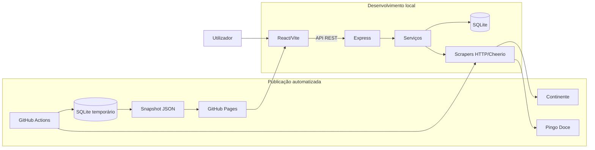

# Radar dos Preços

> Trabalho acadêmico de desenvolvimento de software para comparação de preços de produtos da cesta básica em supermercados portugueses.

**Radar dos Preços** é uma aplicação web que permite ao utilizador selecionar produtos da cesta básica e identificar qual entre o **Continente** e o **Pingo Doce** apresenta o menor total possível para as embalagens selecionadas.

O projeto demonstra a integração de frontend, API REST, persistência relacional, coleta automatizada de dados públicos, validação de ofertas, publicação contínua e regras de comparação. A aplicação está preparada para dois modos de execução:

- **Ambiente local:** React/Vite, API Express e banco SQLite;
- **Ambiente publicado:** GitHub Actions gera um snapshot estático, que é servido pelo GitHub Pages.

Site publicado: https://brunomoscoso.github.io/radardosprecos/

## Índice

- [Visão geral](#visão-geral)
- [Problema e objetivos](#problema-e-objetivos)
- [Arquitetura do sistema](#arquitetura-do-sistema)
- [Tecnologias utilizadas](#tecnologias-utilizadas)
- [Funcionalidades](#funcionalidades)
- [Formulário de feedback e avaliação](#formulário-de-feedback-e-avaliação)
- [Regra de comparação](#regra-de-comparação)
- [Segurança da aplicação](#segurança-da-aplicação)
- [Boas práticas de engenharia de software](#boas-práticas-de-engenharia-de-software)
- [Estrutura do repositório](#estrutura-do-repositório)
- [Modelo de dados](#modelo-de-dados)
- [API REST local](#api-rest-local)
- [Instalação e execução local](#instalação-e-execução-local)
- [Publicação no GitHub Pages](#publicação-no-github-pages)
- [Testes e validação](#testes-e-validação)
- [Limitações conhecidas](#limitações-conhecidas)
- [Documentação complementar](#documentação-complementar)

## Visão geral

O usuário escolhe itens entre uma lista fixa de produtos da cesta básica, salva a seleção no seu próprio navegador e consulta os resultados de comparação. A aplicação não exige cadastro e não compartilha a cesta entre visitantes.

Os dados publicados são recolhidos automaticamente pela aplicação de backend em um ambiente controlado do GitHub Actions. A coleta:

1. percorre o catálogo de produtos elegíveis;
2. consulta os marketplaces configurados;
3. extrai nome, preço, embalagem e link da oferta;
4. valida o formato e a correspondência da embalagem;
5. persiste os resultados em SQLite;
6. gera um JSON público contendo o estado da coleta e a comparação;
7. publica o frontend estático no GitHub Pages.

No site publicado, o frontend não inicia requisições aos supermercados. Ele carrega apenas o snapshot gerado pela última execução bem-sucedida do workflow.

## Problema e objetivos

Comparar preços manualmente em diferentes supermercados pode levar a conclusões incorretas, principalmente quando:

- produtos semelhantes possuem apresentações distintas;
- um item aparece em promoção ou com quantidade ambígua;
- o preço foi recolhido há muito tempo;
- uma coleta falha em apenas um dos mercados;
- uma lista não possui os dois itens necessários para uma comparação completa.

### Objetivos principais

- disponibilizar uma cesta básica configurável;
- comparar o custo de uma embalagem de cada produto selecionado;
- evitar comparar embalagens incompatíveis;
- indicar claramente preços incompletos, antigos ou não verificados;
- preservar o histórico local de preços;
- manter o servidor local independente do processo de publicação;
- testar regras críticas de normalização e persistência;
- separar responsabilidades entre interface, serviços, coleta e dados.

### Escopo funcional

A versão atual compara nove categorias da cesta básica: arroz, feijão, leite, óleo, açúcar, massa, farinha, sal e manteiga. Produtos podem variar quanto à marca, desde que correspondam à quantidade e às características solicitadas.

O sistema não inclui cálculo de portes, promoções por cartão de fidelização, cupons, limites de utilização ou entrega em horário específico.

## Arquitetura do sistema



### Divisão em camadas

| Camada | Responsabilidade |
|---|---|
| Frontend | Renderização, seleção da cesta, armazenamento local e apresentação dos resultados |
| Rotas e controladores | Entrada HTTP e tradução dos serviços para respostas JSON |
| Serviços | Regras de negócio, persistência, comparação e agendamento |
| Scrapers | Comunicação com cada mercado e extração de ofertas |
| Configuração | Inicialização, migração e catálogo de dados |
| SQLite | Histórico de preços e estado das execuções |
| GitHub Actions | Coleta agendada, criação do snapshot e deploy |

### Modos de execução

Em desenvolvimento (`import.meta.env.DEV`), o frontend consulta o backend local por meio de `VITE_API_URL`.

Em produção, o frontend lê `data/prices.json` relativo ao `base` configurado pelo Vite e reaplica localmente a comparação sobre os produtos selecionados. Esta estratégia elimina o custo e o risco de manter uma API pública permanente.

## Tecnologias utilizadas

### Backend

| Tecnologia | Utilização |
|---|---|
| Node.js 22 | Execução JavaScript no servidor e nas ações de automação |
| Express 5 | Servidor HTTP e montagem das rotas REST |
| TypeScript 6 | Tipagem estática e geração de código compilado |
| sqlite3 e sqlite | Persistência transacional local |
| Cheerio | Parsing de HTML recebido dos marketplaces |
| tough-cookie | Gestão de cookies por sessão HTTP |
| dotenv | Carregamento de configurações por ambiente |
| tsx | Execução e observação de código TypeScript |

### Frontend

| Tecnologia | Utilização |
|---|---|
| React 19 | Interface declarativa baseada em componentes |
| Vite 8 | Servidor de desenvolvimento e empacotamento |
| JavaScript ES modules | Implementação da interface |
| CSS | Layout responsivo e estados visuais |
| localStorage | Persistência privada da cesta no navegador |
| ESLint | Verificação estática do código frontend |
| Google Forms | Recolha externa de feedback e avaliação |

### Infraestrutura e operação

| Tecnologia | Utilização |
|---|---|
| GitHub Actions | Agendamento, coleta, testes, build e deploy |
| GitHub Pages | Hospedagem estática do frontend e snapshot |
| SQLite | Banco local e banco temporário durante a publicação |
| NPM | Gestão de dependências e scripts |

Não é utilizado Playwright, Selenium ou outro navegador completo para os scrapers. A coleta usa HTTP, parsing HTML e manutenção controlada de cookies.

## Funcionalidades

### Cesta básica

- seleção individual de produtos elegíveis;
- opção de selecionar ou limpar todos os itens;
- comparação da seleção contra os dois mercados;
- indicação visual de alterações ainda não salvas;
- persistência da cesta no navegador;
- validação do conteúdo lido do `localStorage`.

### Comparação

- total somente quando todos os itens selecionados têm preços utilizáveis;
- subtotal dos preços disponíveis, distinguido do total comparável;
- empates reconhecidos;
- lista de produtos sem preço válido;
- indicação de quantidade incompatível;
- indicação de preço desatualizado;
- indicação de preço histórico ou não confirmado;
- preservação do último preço conhecido em caso de falha, sem participação no vencedor.

### Coleta

- uma execução pode atender aos produtos de ambos os mercados;
- registros separados por execução, mercado e produto;
- estado de sucesso, parcial ou falha;
- recuperação de execuções interrompidas no modo local;
- bloqueio de execuções concorrentes;
- prevenção de execuções repetidas no mesmo horário agendado;
- persistência do histórico sem apagar registros anteriores.

## Formulário de feedback e avaliação

O rodapé da aplicação apresenta o link **Avaliar o site**, que abre um formulário externo em uma nova aba. O formulário foi integrado ao projeto para recolher opiniões dos utilizadores sobre a usabilidade, apresentação visual e utilidade da comparação.

O formulário utiliza o **Google Forms** e não é processado pelo backend Express nem armazenado no SQLite da aplicação.

### Experiência do utilizador

- o componente `FeedbackFooter` é apresentado em todas as páginas da interface;
- o link abre em uma nova aba, mantendo a sessão atual da aplicação;
- a navegação externa é protegida com os atributos `target="_blank"` e `rel="noopener noreferrer"`;
- o formulário pode ser configurado para o ambiente local e para o ambiente publicado;
- se o endereço configurado não estiver válido, a interface apresenta **Avaliação disponível em breve**;
- o projeto não utiliza um modal embutido, evitando recolher respostas sem o contexto da plataforma Google Forms.

### Arquitetura da integração

```text
Utilizador
  -> Rodapé React (FeedbackFooter)
  -> Validação da URL no frontend
  -> Google Forms
  -> Respostas geridas pela plataforma Google
```

A integração não envia os dados da cesta, produtos selecionados, preços ou identificadores internos da aplicação ao formulário. A única ação feita pelo frontend é redirecionar o utilizador para o endereço HTTPS configurado.

O componente valida a URL antes de mostrar o link. São aceitos apenas:

- links HTTPS do domínio `docs.google.com`, no formato de visualização de um Google Forms;
- links HTTPS encurtados do domínio `forms.gle`;
- URLs sem nome de utilizador ou palavra-passe.

URLs HTTP, domínios externos ou links de edição não são apresentados.

### Configuração

No desenvolvimento local, configure em `frontend/.env`:

```dotenv
VITE_FEEDBACK_FORM_URL=https://docs.google.com/forms/d/e/SEU-ID/viewform
```

No GitHub Pages, a URL deve ser definida em **Settings → Secrets and variables → Actions → Variables**, com o nome:

```text
VITE_FEEDBACK_FORM_URL
```

O workflow passa esta variável para o build do Vite no passo de compilação do frontend:

```yaml
env:
  VITE_FEEDBACK_FORM_URL: ${{ vars.VITE_FEEDBACK_FORM_URL }}
```

O valor deve ser o link de **resposta** ou de visualização do formulário, não o link de edição utilizado pela pessoa proprietária do formulário.

O projeto possui um formulário padrão configurado no código como fallback. Para uso público ou acadêmico, recomenda-se definir um formulário próprio na variável de ambiente e desativar a recolha de endereço eletrónico no Google Forms caso não seja necessária.

### Privacidade e consentimento

- o envio das respostas ocorre diretamente na plataforma Google;
- o projeto não recebe nem persiste respostas no banco SQLite;
- não são enviados dados técnicos da cesta para o Google Forms;
- a política de privacidade do formulário deve ser configurada pelo responsável académico do projeto;
- a recolha de dados pessoais deve seguir o consentimento informado e as regras aplicáveis à universidade;
- o formulário não deve solicitar dados desnecessários ou informações sensíveis;
- o projeto não controla cookies ou métricas configuradas pelo Google Forms.

## Regra de comparação

Um preço é considerado utilizável somente quando:

1. existe uma oferta persistida;
2. a quantidade foi identificada e validada;
3. o preço não é histórico legado;
4. a coleta mais recente teve sucesso;
5. o preço pertence à última coleta conhecida;
6. o preço não ultrapassa o limite máximo de idade.

Por padrão, `PRICE_MAX_AGE_HOURS` é `36`. O padrão pode ser alterado, mas deve ser um número maior que zero.

Para declarar um vencedor:

- deve haver pelo menos dois mercados;
- todos os mercados devem ter todos os itens selecionados utilizáveis;
- não pode existir diferença de quantidade entre mercados para o mesmo produto;
- o menor total é calculado em centavos para reduzir problemas de ponto flutuante;
- quando vários mercados atingem o mesmo mínimo, todos são apresentados como vencedores.

Exemplo: um total de 1,10 € somado a 2,20 € é calculado em centavos (110 + 220), produzindo 330 centavos e evitando cálculos inconsistentes em representação binária.

## Segurança da aplicação

### Gestão de informações sensíveis

- o código postal do Pingo Doce é fornecido por variável de ambiente;
- no GitHub Pages, o código postal é armazenado como Secret das Actions;
- o código não é publicado no snapshot JSON nem escrito no código-fonte;
- ficheiros `.env` não devem ser versionados;
- o projeto fornece um `.env.example` sem valores reais.

### Comunicação HTTP e CORS

- o backend permite origens CORS definidas por `FRONTEND_ORIGIN`;
- a leitura pode aceitar uma lista separada por vírgulas;
- o Express limita o corpo JSON a 64 KB;
- o modo local usa bind em `127.0.0.1` por padrão;
- uma origem diferente da origem configurada é rejeitada pelo CORS;
- respostas têm tratamento central de erros.

### Proteção contra abuso

A API local aplica um limite de 120 requisições por IP a cada 60 segundos. O limite inclui resposta HTTP `429` e cabeçalho `Retry-After`.

Quando o sistema estiver atrás de um proxy reverso, `TRUST_PROXY_HOPS` deve ser configurado com o número correto de hops. Isso permite identificar o endereço real do cliente no rate limit sem confiar indiscriminadamente em cabeçalhos encaminhados.

### Validação de entrada

- IDs devem ser inteiros positivos;
- duplicatas não são permitidas;
- a comparação aceita no máximo 100 IDs;
- IDs fora do catálogo são rejeitados;
- os dados do `localStorage` são verificados antes do uso;
- o código postal deve obedecer ao formato português `0000-000`;
- `PRICE_MAX_AGE_HOURS` deve ser positivo;
- parâmetros inválidos produzem mensagens controladas em vez de erros de banco ou exceções internas.

### Sessões HTTP dos scrapers

- cada mercado utiliza uma sessão separada;
- cookies são preservados durante o processo;
- redirecionamentos são manualmente controlados;
- redirecionamentos para outra origem são bloqueados;
- o número máximo de redirecionamentos é limitado a cinco;
- as requisições possuem timeout de 30 segundos;
- respostas diferentes de HTTP 200 encerram a coleta;
- links externos são recusados na extração de ofertas.

### Integridade de dados

- SQL parametrizado é utilizado nas operações de banco;
- migrações usam tabelas e índices com `IF NOT EXISTS`;
- alterações no esquema preservam informações existentes;
- preços antigos não são apagados durante atualizações;
- preços históricos não são associados automaticamente a produtos novos;
- ofertas sem correspondência verificável não são persistidas como preço válido;
- o snapshot anterior só é aceito quando possui estrutura válida.

### Publicação estática

O site publicado não possui rotas para alteração de dados ou execução de coleta. Os binários, banco temporário e dependências são isolados no runner do GitHub Actions. A página serve apenas arquivos estáticos e JSON gerado pela pipeline.

## Boas práticas de engenharia de software

### Arquitetura modular

O projeto separa:

- configuração de banco;
- inicialização e migração;
- catálogo;
- scrapers;
- persistência;
- comparação;
- agendamento;
- API;
- interface.

Essa separação reduz acoplamento e permite testar cada parte independentemente.

### Tipagem

O backend é escrito em TypeScript. A compilação detecta incompatibilidades antes da execução. Os serviços utilizam tipos para produtos, mercados e resultados de comparação.

### Separação entre desenvolvimento e produção

O mesmo frontend possui comportamentos diferentes controlados pelo modo do Vite:

- desenvolvimento usa API dinâmica;
- produção usa arquivo estático versionado pelo processo de deploy.

Isso evita que o site público dispare coleta diretamente.

### Transações e consistência

Inicialização do banco e operações de comparação são protegidas por transações ou blocos explícitos de início e conclusão. A migração sincroniza o catálogo sem apagar o histórico.

### Idempotência

O catálogo usa inserção ou atualização conforme a existência de registros. As migrações podem ser executadas mais de uma vez sem duplicar os índices ou mercados principais.

### Observabilidade

Cada coleta registra:

- origem da execução;
- mercado consultado;
- estado da execução;
- início e término;
- erro por mercado;
- sucesso ou falha por produto.

O frontend apresenta estados parciais e mensagens de falha em vez de ocultar o problema.

### Falhas não destrutivas

Uma falha de coleta não apaga preços anteriores. Os dados antigos são mantidos, mas marcados como não utilizáveis em funções críticas de comparação.

### Testabilidade

Os scrapers podem receber adaptadores falsos nos testes. A persistência usa bancos temporários e diretórios temporários em vez do banco real da aplicação.

### Responsividade e acessibilidade

A interface utiliza HTML semântico, mensagens com `role="alert"` e `role="status"`, legendas ocultas onde apropriado e controle explícito dos estados do botão de salvar.

### Gestão de dependências

Os projetos backend e frontend possuem `package-lock.json` próprios. O uso de `npm ci` em CI garante instalação reproduzível das versões fixadas pelo lockfile.

## Estrutura do repositório

```text
radardosprecos/
├── .github/
│   └── workflows/
│       └── deploy-pages.yml
├── backend/
│   ├── database/
│   │   ├── backups/
│   │   └── database.sqlite
│   ├── src/
│   │   ├── config/
│   │   ├── controllers/
│   │   ├── middleware/
│   │   ├── routes/
│   │   ├── scrapers/
│   │   ├── services/
│   │   └── types/
│   └── tests/
└── frontend/
    ├── public/
    └── src/
```

As diretivas principais são:

- `backend/src/scrapers/markets/`: integrações específicas dos marketplaces;
- `backend/src/scrapers/helpers/`: HTTP, parsing e normalização;
- `backend/src/services/`: regras de negócio;
- `backend/src/config/`: banco, migração e seed;
- `backend/tests/`: testes de integração e HTTP;
- `frontend/src/App.jsx`: gestão da cesta e da comparação;
- `frontend/src/api.js`: acesso à API local;
- `frontend/src/FeedbackFooter.jsx`: validação e apresentação do link de feedback;
- `frontend/src/FeedbackFooter.css`: estilos e estados de acessibilidade do componente;
- `.github/workflows/deploy-pages.yml`: pipeline de publicação.

## Modelo de dados

As entidades principais são:

| Tabela | Responsabilidade |
|---|---|
| `produtos` | Catálogo e estado de elegibilidade da cesta |
| `mercados` | Continente e Pingo Doce |
| `precos` | Histórico de ofertas encontradas |
| `execucoes` | Coordenação completa de uma coleta |
| `coletas` | Coleta associada a um mercado |
| `coleta_resultados` | Resultado por produto em uma coleta |
| `cesta` | Compatibilidade com dados históricos locais |

A seleção atual do usuário não é persistida no banco da aplicação. O frontend usa `localStorage`.

### Views utilizadas

- `ultimos_precos`: resolve o preço mais recente por produto e mercado;
- `cesta_precos`: combina todos os produtos elegíveis com os dois mercados;
- `ultimas_consultas`: apresenta o resultado mais recente de cada item.

Exemplos de consulta:

```sql
SELECT * FROM cesta_precos
ORDER BY produto, mercado;

SELECT * FROM ultimas_consultas
ORDER BY produto, mercado;

SELECT * FROM ultimos_precos;
```

O conteúdo de uma view não garante que o preço seja utilizável. A idade, coleta recente e equivalência da embalagem são verificadas pelo serviço de comparação.

## API REST local

Todos os endpoints abaixo são consultas. O backend local não expõe uma rota pública para gravar cesta ou iniciar coleta.

| Método | Endpoint | Descrição |
|---|---|---|
| `GET` | `/health` | Estado do serviço |
| `GET` | `/products` | Catálogo de produtos |
| `GET` | `/markets` | Mercados configurados |
| `GET` | `/prices` | Últimos preços persistidos |
| `GET` | `/compare/basket?productIds=1,2` | Comparação dos IDs informados |

As respostas de dados seguem o formato:

```json
{
  "success": true,
  "data": {}
}
```

Em caso de erro conhecido, a API devolve `success: false` e uma mensagem. Erros internos são escondidos do cliente e registrados no servidor.

## Instalação e execução local

### Pré-requisitos

- Node.js 22.12 ou posterior;
- NPM;
- PowerShell no Windows;
- código postal válido para Pingo Doce.

### 1. Configurar backend

```powershell
cd backend
npm ci
Copy-Item .env.example .env
```

Edite `backend/.env` e configure pelo menos:

```dotenv
PINGO_DOCE_POSTAL_CODE=0000-000
FRONTEND_ORIGIN=http://localhost:5173
```

Inicie:

```powershell
npm run dev
```

O backend usa `http://127.0.0.1:3000` por padrão.

### 2. Configurar frontend

Em outro terminal:

```powershell
cd frontend
npm ci
npm run dev
```

A URL normalmente será `http://localhost:5173`.

### Variáveis do backend

| Variável | Padrão | Finalidade |
|---|---|---|
| `PORT` | `3000` | Porta HTTP |
| `HOST` | `127.0.0.1` | Interface de escuta |
| `FRONTEND_ORIGIN` | `http://localhost:5173` | Origem aceita pelo CORS |
| `DATABASE_PATH` | `backend/database/database.sqlite` | Caminho do SQLite |
| `PINGO_DOCE_POSTAL_CODE` | obrigatório | Localização de entrega em casa |
| `TRUST_PROXY_HOPS` | não definida | Saltos confiáveis em proxy |
| `SCRAPE_ENABLED` | `true` | Ativa o agendador local |
| `SCRAPE_TIMEZONE` | `Europe/Lisbon` | Fuso dos horários |
| `SCRAPE_TIMES` | `08:00,20:00` | Horários locais |
| `PRICE_MAX_AGE_HOURS` | `36` | Validade máxima do preço |

### Variável do frontend

| Variável | Padrão | Finalidade |
|---|---|---|
| `VITE_API_URL` | `http://localhost:3000` | Endereço da API no modo local |
| `VITE_FEEDBACK_FORM_URL` | formulário padrão configurado no componente | Link HTTPS do Google Forms usado no rodapé |

## Publicação no GitHub Pages

O workflow [deploy-pages.yml](.github/workflows/deploy-pages.yml) executa a pipeline nas seguintes situações:

- push na branch `main`;
- agenda diária às 08:00 e 20:00 UTC;
- execução manual em Actions.

### Configuração

1. Em **Settings → Secrets and variables → Actions**, crie `PINGO_DOCE_POSTAL_CODE` no formato `0000-000`.
2. Em **Settings → Pages**, selecione **GitHub Actions** como origem.
3. Faça push para `main` ou execute o workflow manualmente.

### Etapas da pipeline

1. checkout do repositório;
2. configuração do Node.js 22;
3. instalação reproduzível das dependências;
4. inicialização do SQLite temporário;
5. execução das coletas;
6. geração de `frontend/public/data/prices.json`;
7. lint e build do frontend;
8. upload do artefato;
9. deploy no GitHub Pages.

O snapshot anterior é carregado para manter o último preço conhecido em caso de falha. Porém, esse preço não entra no total comparável. HTTP diferente de 200 ou JSON inválido no snapshot anterior impede a substituição incoerente da publicação.

## Testes e validação

Os testes usam Node Test Runner e SQLite temporário.

### Executar backend

```powershell
cd backend
npm test
npm run build
npm run scrape
```

`npm run scrape` realiza uma coleta real do catálogo configurado e deve ser usado conscientemente, pois depende dos sites externos.

### Executar frontend

```powershell
cd frontend
npm run lint
npm run build
```

### Áreas cobertas pelos testes

- normalização de unidades gramas, litros e mililitros;
- recusa de embalagens múltiplas e quantidades promocionais ambíguas;
- rejeição de variantes não solicitadas;
- correspondência de produto;
- validação do código postal do Pingo Doce;
- entrega em casa ou recusa de escolha de loja;
- manutenção de cookies em redirecionamentos;
- bloqueio de origem externa;
- migração idempotente;
- preservação de preços históricos;
- migração da cesta sem reutilizar preços antigos;
- acumulação e leitura do histórico;
- cálculos em centavos;
- empates e cestas vazias;
- falhas parciais;
- snapshot com carry-forward não utilizável;
- IDs inválidos;
- views sem duplicação de histórico.

Os testes não dependem dos marketplaces reais: são usados adaptadores falsos, HTML controlado e bancos temporários.

## Limitações conhecidas

- os seletores dependem da estrutura HTML atual dos sites e podem exigir manutenção;
- somente a primeira página de resultados é analisada;
- o Pingo Doce depende da confirmação de entrega para o código postal configurado;
- a seleção de loja não é suportada;
- não há histórico completo no site público estático;
- o GitHub Actions pode atrasar execuções agendadas;
- não há garantia de disponibilidade dos sites externos;
- promoções, fidelização e portes não são considerados;
- o localStorage representa apenas o navegador do usuário;
- o rate limit em memória não é distribuído entre várias instâncias;
- o projeto não implementa autenticação, porque não há área administrativa nem dados privados do usuário;
- o HTTPS é responsabilidade da plataforma de hospedagem e do ambiente de execução.

## Limitações acadêmicas e decisões de projeto

O projeto privilegia transparência e segurança de comparação em vez de converter automaticamente ofertas incertas em vencedor.

Consequentemente:

- um preço antigo pode ser mostrado como informação, mas não entra no total;
- uma embalagem não verificada não determina o menor total;
- uma falha parcial não elimina o histórico;
- o vencedor só existe com dados completos e equivalentes;
- o site estático não tenta coletar dados no navegador do usuário.

Estas decisões evidenciam separação entre **dados obtidos**, **dados válidos para comparação** e **resultado apresentado ao usuário**.

## Comandos resumidos

```powershell
# Backend
cd backend
npm ci
npm run dev
npm test
npm run build
npm run scrape

# Frontend
cd frontend
npm ci
npm run dev
npm run lint
npm run build
```

## Documentação complementar

Para detalhes adicionais sobre o estado atual da implementação, consulte [CONTEXTO-APLICACAO-IA.md](CONTEXTO-APLICACAO-IA.md).
